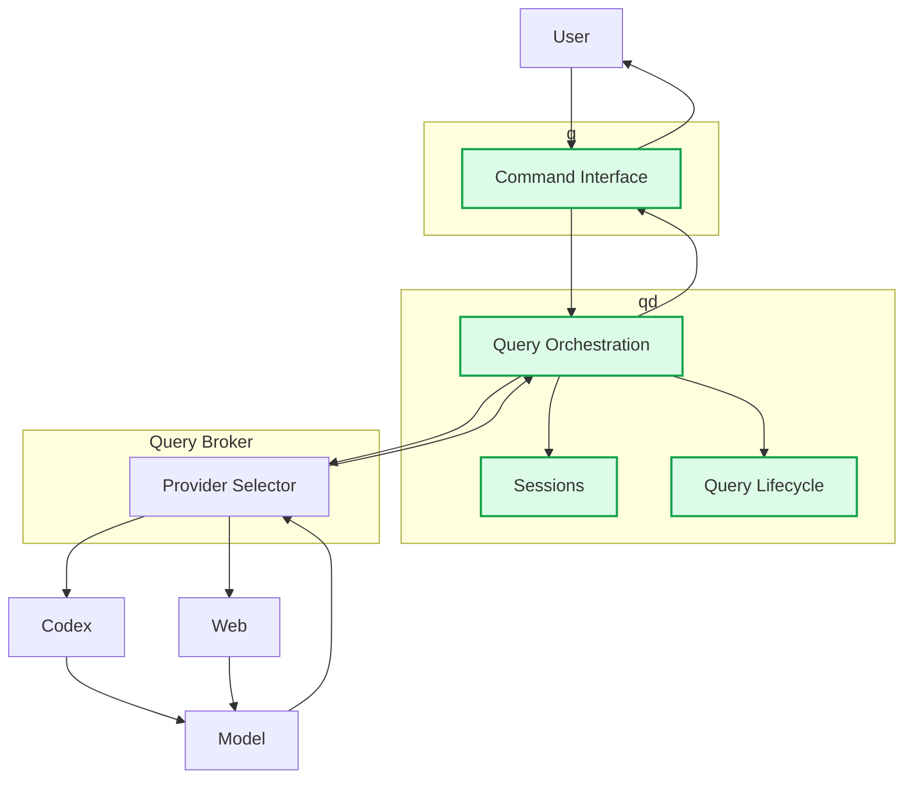

# q / qd

`q` is a terminal client for submitting queries to AI backends through a persistent local daemon.

`qd` provides the long-lived query environment behind `q`, including sessions, query lifecycle management, and coordination with the query broker.

## Architecture



`q` is the command-line interface. `qd` owns the persistent query environment and coordinates work through the query broker, which selects the provider used for a query.

## Installation

Requirements:

- Python 3.13+
- a compatible `chatgpt-query-broker` installation
- Codex authentication for Codex-backed queries

Install from the repository:

```sh
./scripts/install-user.sh
```

Verify the installation:

```sh
command -v q
command -v qd
systemctl --user is-active qd.service
```

See [docs/installation.md](docs/installation.md) for detailed installation and upgrade documentation.

## Usage

Submit a query:

```sh
q "Explain this function"
```

Use a named session:

```sh
q -s reverse-engineering "Analyze this function"
q -s reverse-engineering "Continue from the previous result"
```

Select a model or reasoning level:

```sh
q -m gpt-6-sol "Review this"
q -r xhigh "Review this carefully"
```

Include UTF-8 text files in the prompt:

```sh
q -i source.c "Analyze this"
q -i old.c -i new.c "Compare these"
```

Attach local files:

```sh
q --attach capture.pcap "Analyze this capture"
q --attach recording.wav "Inspect this audio file"
q --attach image.png "Describe this image"
```

Multiple attachments may be supplied:

```sh
q \
  --attach capture.pcap \
  --attach notes.pdf \
  "Analyze these files"
```

Read input from stdin:

```sh
cat notes.txt | q
cat source.c | q "Analyze this code"
```

Run a detached query:

```sh
q -q "Run this task"
```

Buffer output until the query completes:

```sh
q --no-stream "Explain this"
```

Select a sandbox:

```sh
q --sandbox read-only "Inspect this project"
q --sandbox workspace-write "Make the requested changes"
```

Control tool availability:

```sh
q --tools "Inspect the repository"
q --no-tools "Answer without optional tools"
```

Further documentation:

- [Configuration](docs/configuration.md)
- [Operations](docs/operations.md)
- [Logging](docs/logging.md)
- [State and recovery](docs/state-and-recovery.md)
- [Security](docs/security.md)
- [Service control](docs/service-control.md)
- [Development](docs/development.md)
