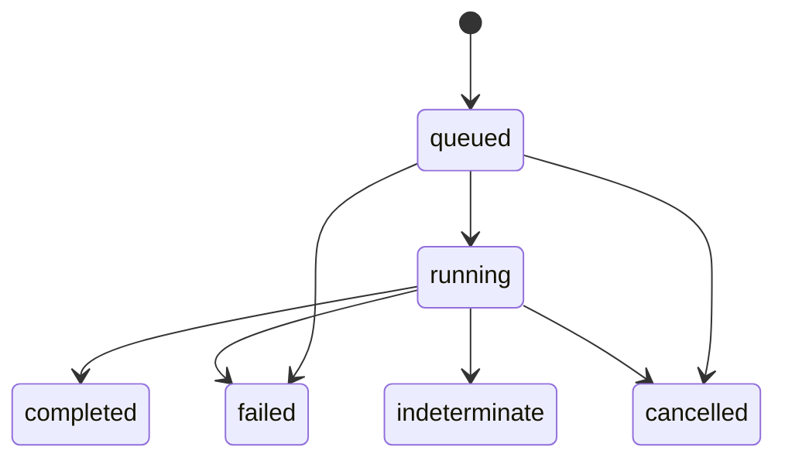

# State and Recovery

## Durable state

SQLite database:

    ~/.local/share/q/q.sqlite3

Runtime socket:

    $XDG_RUNTIME_DIR/q/qd.sock

Runtime lock:

    $XDG_RUNTIME_DIR/q/qd.lock

Default state directory:

    ~/.local/state/q/

## Query states

Queries use these durable states:

    queued
    running
    completed
    failed
    indeterminate
    cancelled

Allowed lifecycle:

Terminal states are not silently replayed.

## Named sessions

A q session name can hold one persistent broker conversation binding per provider.

A new named session starts without provider bindings. The first successful persistent query to a provider establishes that provider's binding.

If exactly one provider binding exists and a later query does not select a provider, qd reuses that binding. If multiple provider bindings exist, the query must select a provider.

A provider binding is stable: qd does not silently replace an existing provider conversation with a different one.

Queries for the same named session are serialized.

Queries for unrelated sessions can execute concurrently.

## Restart behavior

qd owns recovery.

Completed queries remain replayable after daemon restart because qd follow can
reconstruct their output from durable per-query NDJSON logs.

Queued queries are safe to schedule again after restart because they had not yet
crossed the local execution boundary into an upstream turn.

`install-user.sh` protects this boundary with qd's restart guard. Once the
guard is acquired, new submissions are refused and queued work cannot become
running until the guard is released, its lease expires, or the daemon restarts.
If running work already exists, the installer refuses the restart instead.

Restart-guard ownership is represented by an opaque token. The default lease is
300 seconds, and the installer renews that lease immediately before restart.
Automatic lease expiry ensures abandoned guards do not permanently block qd.

A query found in running state after an unguarded daemon restart becomes:

    indeterminate

qd never blindly replays that upstream operation.

If that query belonged to a named session, the session is marked:

    broken

## Cancellation

`qd cancel QUERY_ID` records the cancellation request and asks the broker to interrupt the active provider operation when conversation and execution IDs are available.

When the selected provider supports interruption and the interrupt succeeds, the query transitions to:

    cancelled
